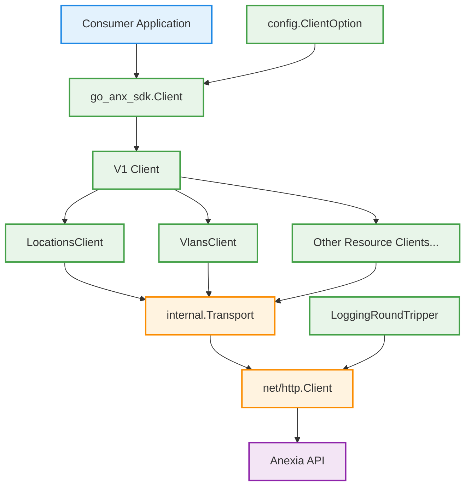
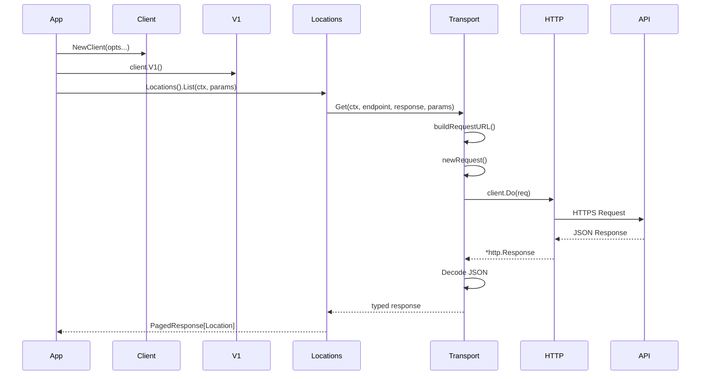

# Go Anexia API Client

A Go client for the Anexia Engine API.

This SDK provides a simple, versioned interface for interacting with Anexia resources such as locations and VLANs.

The project is still in early development.

## Installation

```bash
go get github.com/anexia/go-anxsdk
```

## Usage

The following shows how to use the api client.

```go
func main() {
    ctx := context.Background()

    apiKey := os.Getenv("API_KEY")

    client := go_anx_sdk.NewClient(
        config.WithAPIKey(apiKey),
        config.WithHttpClient(&http.Client{
            Transport: utils.NewLoggingRoundTripper(http.DefaultTransport),
        }),
    )

    locations, err := client.V1().Locations().List(ctx, v1.LocationListParams{})
    if err != nil {
        log.Fatal(err)
    }

    for _, l := range locations.Data {
        fmt.Printf("%+v\n", l)
    }
}
```

## API

### Versioning

All endpoints are accessed via a versioned client:

```go
// entry point to the v1 api endpoints
v1Client := client.V1()

// v1 locations api endpoints
locationV1Client := client.V1().Locations()
```

### Structure

The following diagram explains the structure of the api client and how it is used end to end.



The following diagram explains how a request flows through the different architectural layers.



## Configuration

The client is configured using functional options:

- WithApiKey(string) - required or api will return a 401
- WithBaseURL(string) - if omitted 'https://engine.anexia-it.com' will be used
- WithHttpClient(*http.Client) - if omitted the default `http.Client` will be used

## Pagination

Pagination is achieved by leveraging go's new standard library `iter.Seq2` type.
The `paging.Paginate` function accepts any `paging.PageFetcher` which is provided by any client that returns paged data.

Example of iterating over all clusters:
```go
clusterList := paging.Paginate(ctx, client.V2().Kubernetes().Clusters().ListPageFetcher(kubernetes.ClusterListParams{}))
for cluster, err := range clusterList {
	if err != nil {
		panic(err)
	}

	fmt.Printf("%+v\n", cluster)
}
```

In some `v2` APIs, a `ListFull` is available with all fields already filled. Use as following:

```go
clusterList, err := client.V2().Kubernetes().Clusters().ListFull(ctx, paging.DefaultParams(), kubernetes.ClusterListParams{})
if err != nil {
	panic(err)
}
for _, cluster := range clusterList.Data {
	fmt.Printf("%+v\n", cluster)
}
```

For older API endpoints, iterating over all items and fetching the details (in case the list response item is not enough), the `paging.PaginateAndLoad` function can be used.
This function internally uses the `paging.Paginate` function and a provided `paginate.ItemFetcher` to load each item.

Example of iterating over all clusters and fetching each clusters details:

```go
clusterClient := client.V1().Clusters()
clusters := paging.PaginateAndLoad(ctx, clusterClient.ListPageFetcher(v1.ClusterListParams{}), clusterClient.Get)
for cluster, err := range clusters {
    if err != nil {
        panic(err)
    }

    fmt.Printf("%+v\n", cluster)
}
```

## Error handling

TBD

## Testing
Tests can be executed by running

```bash
just test
```

### Fakes

The SDK ships with fakes for every client, usable in other projects to unit-test code that
depends on the SDK without hitting the real API. The top-level fake client is hand-written;
all sub-clients are generated by counterfeiter.

Every client has a companion interface that its `Client` struct implements:
- leaf clients use the `XxxAPI` suffix, e.g. `core.LocationsAPI`
- entry clients use the plain `API` name in their package, e.g. `core.API`, `v1.API`
- the root entry point is `anxsdk.ClientAPI`

The generated fakes live in the `fake/` directory, mirroring the SDK's `v1/`/`v2/` tree. Each
SDK package has a companion package named `<pkg>fake` that implements the same interfaces as the
real clients (e.g. `corefake`, `ipamfake`, `v1fake`, `vspherefake`, `kubernetesfake`). They expose
`Returns`, `ReturnsOnCall`, `Stub`, `CallCount` and `ArgsForCall` helpers.

#### Starting from a full fake client

`anxsdkfake.NewClient()` returns a hand-written `*anxsdkfake.Client` that implements
`anxsdk.ClientAPI` and is fully pre-wired: every entry client returns the generated fake of the
corresponding real client, so the whole tree is safe to navigate. Configure the fakes you care
about via the getters.

```go
func listFakeLocations() {
	ctx := context.Background()

	// NewClient returns a fully pre-wired fake client tree. Configure the fake
	// clients you care about via the getters.
	client := anxsdkfake.NewClient()
	client.Locations().ListReturns(
		paging.PagedResponse[core.LocationListItem]{
			Data: []core.LocationListItem{
				{Identifier: "anx01-identifier", Name: "ANX01 - Klagenfurt"},
				{Identifier: "anx04-identifier", Name: "ANX04 - Wien"},
			},
		},
		nil,
	)

	// The fake client implements the same interfaces as the real client.
	page, err := client.V1().Core().Locations().List(ctx, paging.DefaultParams(), core.LocationListParams{})
	if err != nil {
		panic(err)
	}

	for _, loc := range page.Data {
		_, _ = fmt.Printf("%s\t%s\n", loc.Identifier, loc.Name)
	}
}
```

Unconfigured fake clients return zero values (empty responses, nil errors), and fakes record
invocations via `CallCount`/`ArgsForCall`.

To regenerate the generated fakes after changing an interface, run `just generate`.
The counterfeiter tool is pinned as a Go tool (`go tool counterfeiter`) via the
`tool` directive in `go.mod`, so it is not part of the SDK's compiled dependencies and does not
affect downstream projects.

## License

TBD